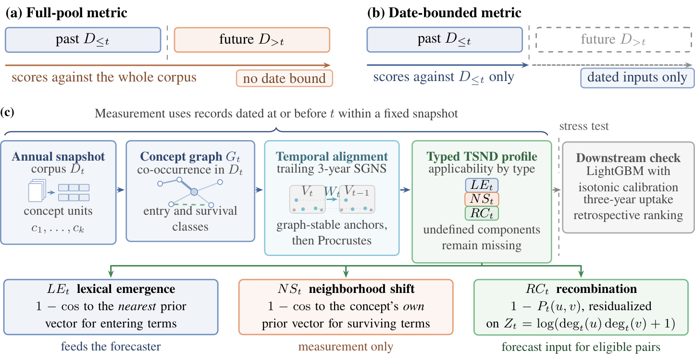

# TSND

Temporal Semantic Novelty Decomposition (TSND) measures lexical emergence, aligned
same-term displacement and degree-conditioned pair recombination in scientific concept
histories. Components retain their eligibility rules and missing prior-vector coverage.
The code includes the temporal measurements, structural and semantic baselines, cohort
construction, uptake prediction and conditional dependence-sensitivity analyses.



[Method diagram as PDF](assets/method.pdf)

## Installation

Use Python 3.11 from the repository root.

```bash
git clone https://github.com/gxCaesar/TSND.git
cd TSND
python3.11 -m venv .venv
source .venv/bin/activate
python -m pip install -r requirements.txt
python -m pip install --no-deps -e .
```

The runtime versions used for the analyses are pinned in `requirements.txt`.
Optional text extraction, pretrained encoders and survival models are available through
`.[text]`, `.[encoders]` and `.[survival]`. The generic text path uses spaCy and its
`en_core_web_sm` model. Model files are obtained separately under their respective terms.
The core example below runs on a CPU without downloading models or data.

```bash
PYTHONPATH=src python examples/offline_profile.py
```

The example prints JSON with `input_type: synthetic_example`,
`graph_entry_cause: df_threshold`, two pairs with prior proximity, and `b|c` as a pair
without prior proximity. It demonstrates that graph entry can follow an earlier raw
observation and that an undefined component stays missing.

## Code layout

| Location | Contents |
| --- | --- |
| `src/tsnd/data/` | Acquisition, text/MeSH processing, annual graphs and chronological splits |
| `src/tsnd/models/` | Temporal embeddings, alignment, novelty components and baselines |
| `src/tsnd/training/` | Uptake prediction and calibration |
| `src/tsnd/journal/` | Observation histories, fixed outcomes, matched populations and sensitivity analyses |
| `src/tsnd/evaluation/` | Ranking metrics and scientific perturbation analyses |
| `configs/` | Scientific configurations |
| `scripts/` | Runnable acquisition, preparation and analysis entry points |
| `examples/` | Small synthetic example |
| `assets/` | Finished method illustration |

## Obtain the data

The source is [OpenAlex](https://openalex.org/).
Its [source metadata are CC0](https://help.openalex.org/access/overview/).
The study uses four distinct dated acquisitions:

| Collection | Retrieval date | Publication years | Retained rows |
| --- | --- | --- | --- |
| Generic, subfields 1702/3104/2204 | 13 June 2026 | 2010-2024 | 619,554 memberships |
| Oncology, subfield 2730 | 15 June 2026 | 2010-2024 | 222,237 memberships |
| Cardiology, subfield 2705 | 16 June 2026 | 2010-2019 | 145,878 memberships |
| Oncology reference, subfield 2730 | 17 October 2026 | 2010-2019 | 163,616 unique works |

Membership counts across collections are not counts of mutually distinct works.
The October reference is a separate acquisition, not an uncapped reconstruction of June.

### Dated study inputs

The exact retained records and saved predictions are prepared in the separate article data
attachment, Online Resource 1 (`ESM_1.zip`, 610.679 MB). A public download URL for this
archive has not yet been assigned. Use the article's supplementary-data link when available.
The code repository does not contain the bulk corpus or prediction arrays.

After obtaining the archive, extract it:

```bash
mkdir -p data/frozen
unzip /path/to/ESM_1.zip -d data/frozen
```

The archive contains:

| Path under `data/frozen/source-data/` | Contents |
| --- | --- |
| `snapshots/oncology_20260615/` | Historical oncology annual input tables |
| `snapshots/generic_20260613/` | Historical generic annual input tables |
| `snapshots/cardiology_20260616/` | Historical cardiology annual input tables |
| `snapshots/oncology_20261017/` | Complete October oncology reference |
| `predictions/june/`, `predictions/october/` | All 590 saved comparison prediction tables |
| `datasets.json` | File names, row counts, columns and sizes |
| `resampling/` | Paired seed AP summaries and saved conditional-draw gains |

Each input is `works_YEAR.parquet`. MeSH analyses use `id`, `year`, `mesh`,
`venue_id` and `subfield_ids`. The October reference additionally preserves
`acquisition_rank`. Generic text extraction requires `abstract` and `concepts`.
Keep the original row order. Pair identifiers are canonicalized as `u|v`.

### Acquire a new reference

For a new acquisition, obtain an activated key through
[OpenAlex API settings](https://help.openalex.org/api/authentication/) and provide it
through the environment:

```bash
export OPENALEX_API_KEY="YOUR_OPENALEX_API_KEY"
PYTHONPATH=src python scripts/journal_collect_reference.py \
  --output-dir data/current_reference
```

The collector queries 2010-2019 oncology works with an indexed abstract and PubMed
identifier, follows cursor pagination, and saves yearly Parquet tables with acquisition
order. It resumes partial collections in the same directory. This MeSH reference path
does not download abstract text. Generic text acquisition is available through the
`data` stage of `tsnd.cli` with `configs/base.yaml`.

A new query creates a newly dated corpus. It cannot reproduce the exact historical
snapshots or historical annotation availability. Use the saved dated inputs for the
reported comparisons.

## Prepare graphs, labels and temporal features

MeSH processing removes check tags, retains at most 40 units per paper, and builds annual
co-occurrence graphs at document-frequency (DF) thresholds 10, 20 or 30. Raw observation
history is computed before annual DF filtering and per-paper truncation. SGNS minimum
count remains 20, so graph eligibility and prior-vector availability are distinct.
Degree is the number of distinct partners, including in the function named
`weighted_degree`.

For the historical oncology analysis, copy `configs/mesh_onco_10seed.yaml` to a local
configuration and set these paths:

```yaml
data:
  out_dir: data/frozen/source-data/snapshots/oncology_20260615
artifacts:
  out_dir: artifacts/df20
```

Change only those entries in the full configuration. Preserve its other parameters.
Build the DF20 graphs through 2019 for three-year outcomes and then construct labels:

```bash
PYTHONPATH=src python -m tsnd.cli preprocess --config configs/local_df20.yaml
PYTHONPATH=src python -m tsnd.cli label --config configs/local_df20.yaml
```

Outcome tables contain `t`, `kind`, `key`, breadth, cutoff and binary label.
Keep these DF20 labels fixed across observation conditions and thresholds.
The journal comparisons train on 2011-2015 cohorts and evaluate 2016 with a three-year
uptake horizon. Later annual graphs supply outcomes, not earlier feature observations.

Build each condition's temporal features through 2016:

```bash
TSND_INPUT="data/frozen/source-data/snapshots/oncology_20260615"
for df in 10 20 30; do
  PYTHONPATH=src python scripts/journal_prepare_inputs.py \
    --config configs/mesh_onco_10seed.yaml --data-dir "$TSND_INPUT" \
    --output-dir "results/df$df" --condition "df$df" --min-df "$df" \
    --year-end 2016 --seeds 0 1 2 3 4 5 6 7 8 9
done
```

This produces `terms/year_YEAR.pkl`, `embed/emb_YEAR_sSEED.npz`, alignment artifacts
and `decompose/decomp_YEAR_sSEED.pkl`. SGNS uses trailing three-year windows.
Alignment uses graph-stable anchors and Procrustes. Preserve the original worker count
for a result-matching run; changing parallel SGNS settings can change fitted vectors.
Pickle artifacts should come from a trusted source. Use fresh scientific output directories.

Classify raw and processed histories against the fixed labels:

```bash
PYTHONPATH=src python scripts/journal_cohort_sensitivity.py \
  --data-dir "$TSND_INPUT" --terms-dir results/df20/terms \
  --condition df10=results/df10/terms --condition df30=results/df30/terms \
  --labels-dir artifacts/df20/labels --output-dir results/classified \
  --years 2011 2012 2013 2014 2015 2016
```

The outputs include `classified_CONDITION_YEAR.parquet`, raw first/last observations,
graph-entry causes, cohort flags and population counts. Missing labels are not replaced
by negatives. Exclude candidates without a frozen label before constructing matched
populations. For matched comparisons, use
`tsnd.journal.fixed_outcomes.common_membership` separately in every train/test year to
intersect both IDs and the requested cohort flag. Save the resulting `year_YEAR.parquet`
files in the selected common-ID directory.

## Run uptake comparisons

```bash
PYTHONPATH=src python scripts/journal_rc_ablation.py \
  --config configs/mesh_onco_10seed.yaml --data-dir "$TSND_INPUT" \
  --terms-dir results/df20/terms --embed-dir results/df20/embed \
  --decomp-dir results/df20/decompose --labels-dir artifacts/df20/labels \
  --condition df20 --cohort adjacent --cohort-condition df20 \
  --cohort-dir results/classified --train-years 2011..2015 --test-year 2016 \
  --seeds 0..9 --output-dir results/df20_adjacent
```

Use `--cohort graph_first_observed` or `--cohort raw_first_observed` for the corresponding
history subset. Add `--common-ids-dir PATH` for matched populations.
The runner writes `predictions_sSEED.parquet` and `summary.json`.

The pair-only groups are S, S+P, S+Z, S+R, S+P+Z, S+P+R and S+P+Z+R.
S is the original B2+B7 structural feature union, P is prior cosine proximity,
Z is the current log degree product, and R is the fitted recombination residual.
`--legacy-mixed` also runs the original mixed term/pair comparison with its original
feature order. Native missing values are retained.

### Same-snapshot document views

Use `tsnd.journal.corpus_views.materialize_corpus_views` on the complete October
reference with cap 15,000, sampling seeds 0-9 and `selection_year_end=2016`.
This produces full, API-order and ten random views. Future outcome records remain complete.
Prepare each view's feature inputs with the same scientific settings.

Use `tsnd.journal.fixed_outcomes.build_fixed_reference_outcomes` with the full DF20
graphs and full raw reference to create shared labels and view-specific candidates.
The full outcome graphs must cover all windows through 2019, including the 2012-2018
windows used by training cohorts. Classify histories, intersect memberships for common-ID
analyses, and run the same feature-group comparisons. Never estimate outcome cutoffs
from sampled future records.

### Conditional dependence sensitivity

Pass all saved prediction files from a study into one invocation so feature groups,
cohorts, thresholds and views share the same concept-weight draws. Run the June and
October studies separately because their concept universes differ.

```bash
PYTHONPATH=src python - <<'PY'
from pathlib import Path
import subprocess
import sys

files = sorted(Path("data/frozen/source-data/predictions/june").rglob("predictions_s*.parquet"))
if not files:
    raise SystemExit("No saved predictions found")
subprocess.run([
    sys.executable, "scripts/journal_rc_ablation.py",
    "--prediction-files", *map(str, files),
    "--output-dir", "results/june_sensitivity",
    "--resamples", "2000", "--uncertainty-seed", "20261017",
], check=True)
PY
```

The output is `dependence_sensitivity.json`. The point estimate averages seed-paired
noninterpolated average-precision differences across ten model seeds. Seed SD and
conditional multiplier intervals remain separate. For direct contrasts, subtract the
matched draw-index gains rather than independently generated bounds. These conditional
intervals do not carry guaranteed population coverage.

## Temporal and component-response analyses

```bash
PYTHONHASHSEED=0 PYTHONPATH=src python scripts/journal_native_a9.py \
  --config configs/mesh_onco_10seed.yaml --data-dir "$TSND_INPUT" \
  --output-dir results/native_invariance --year 2016 --seeds 0 1 2 3 4 5 6 7 8 9

PYTHONPATH=src python scripts/a10_strict.py results/df20 2016 0,1,2
```

The first command compares date-bounded native graphs, vectors and profiles, using
one SGNS worker and a future-pooling control. The second reports response-only, strict
and dominance component criteria from the saved temporal artifacts. Both relabel and
drift criteria change across attribution rules. These are component-response measures,
not proof of independent latent factors.

## Interpretation and licence

TSND describes corpus-relative profiles. Graph entry is not first conceptual invention,
and uptake ranking uses retrospective labels. Prediction comparisons do not establish a
universal predictive advantage. Saved gain replay and a new complete study run answer
different reproducibility questions; the archive does not include trained model weights,
embeddings, processed graphs, binary environments or original concept-weight vectors.

The software is distributed under the MIT licence in `LICENSE`. Source data and
third-party model terms remain separate. The software licence does not assign a new
licence to author-generated datasets.
